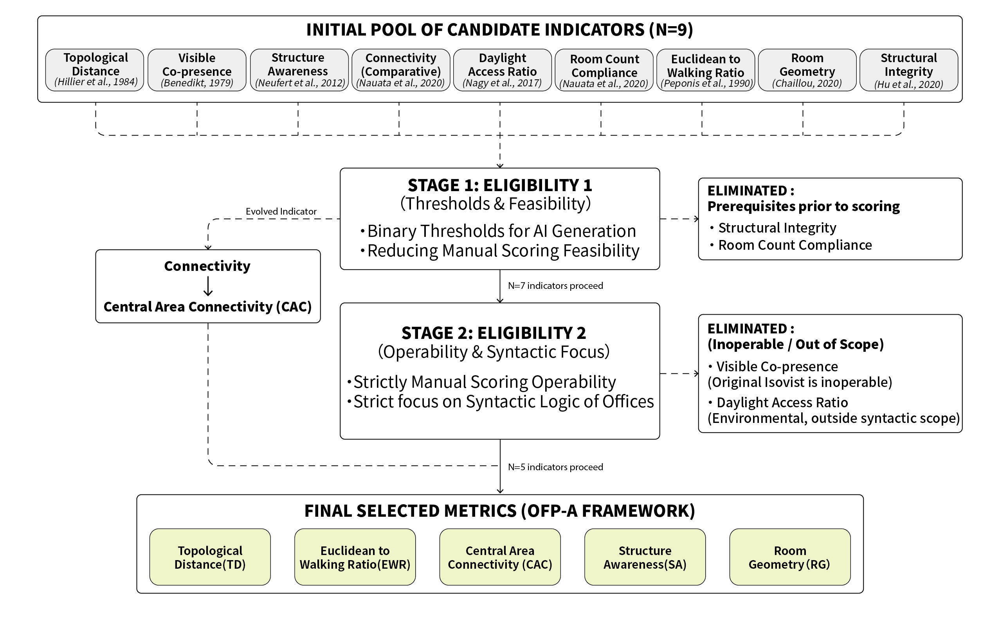
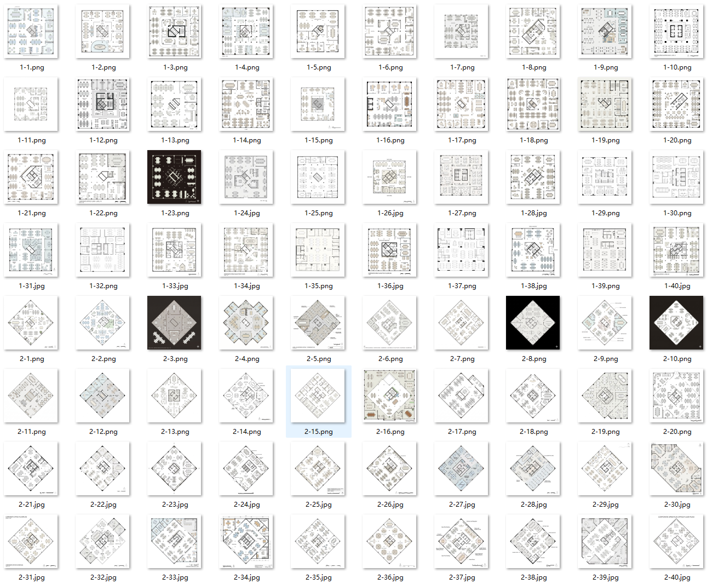
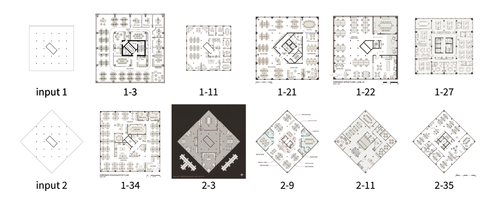

# OFP-A：AI 生成办公平面评价

AI 可以很快生成很多办公平面，但“看起来还行”并不等于真的好用。所以想做一套比较清楚的办法，把空间逻辑、结构和人的判断放在一起评价。



## 我做了什么

- 设计了两种带结构约束的基础平面，并生成了 80 个办公平面样本。
- 从最初的评价想法中筛出 5 个指标：TD、EWR、SA、CAC 和 RG。
- 对 80 个样本进行人工标注，再用 K-means 分成 10 类，选出每一类中最有代表性的样本。
- 请 20 名建筑相关专业的人对代表样本进行 10 分制评价。
- 用 Z-score 和 T-score 减少不同人的打分习惯差异。
- 用带约束的 SLSQP 优化，让 5 个指标的组合尽量接近人的评价。

## 五个指标

| 指标 | 观察的内容 |
| --- | --- |
| TD | 拓扑距离 | 房间连接关系和理想关系之间的差距 |
| EWR | 欧氏距离与步行距离比 | 直线距离与实际步行距离的差异 |
| SA | 结构感知 | 平面是否尊重柱网和结构关系 |
| CAC | 核心区连通性 | 中央区域和周边空间是否容易到达 |
| RG | 房间几何 | 房间形状是否规整、是否容易使用 |

## 结果

最后拟合得到的权重是：

- CAC：30.89%
- SA：27.52%
- RG：18.00%
- TD：16.21%
- EWR：7.39%

比较有意思的地方是：人的总体判断最在意的不是单纯的最短路径，而是中央区域是否好用、结构是否清楚。这也说明，生成平面不能只靠视觉效果来判断。





## 文件说明

- `analysis/kmeans/`：80 个样本的数据、K-means 脚本和输出结果。
- `analysis/weighting/`：人的评分数据和 SLSQP 权重计算脚本。
- `assets/`：评价框架、生成样本和代表样本图片。

## 运行

```bash
pip install -r requirements.txt
python analysis/kmeans/analyze_kmeans.py
python analysis/weighting/weighting_calculation.py
```

## 目前还不完整的地方

这套方法目前仍有不少人工步骤，例如门、墙、房间关系的标注。样本数量和问卷人数也不算大，所以这些权重更适合作为一次验证结果，而不是通用标准。下一步会尝试自动识别平面元素，并测试更多类型的办公平面。
